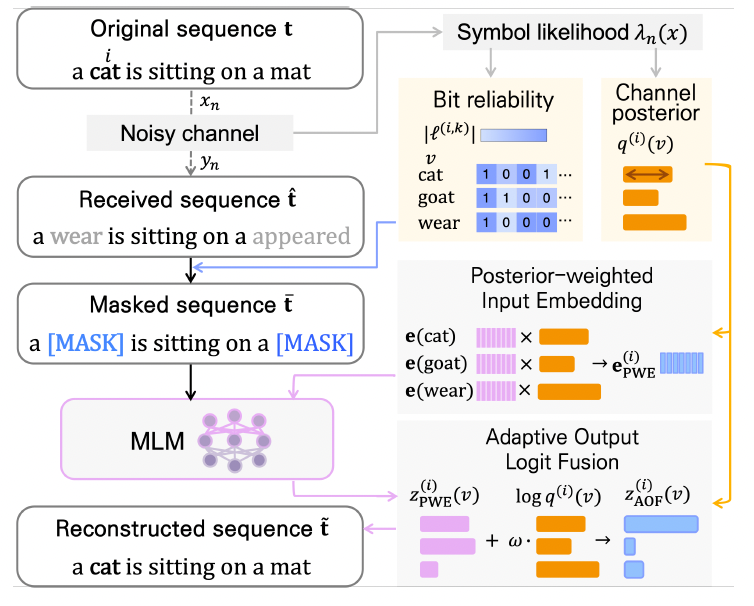

# Channel-Adaptive MLM

**Dual-Stage Channel-Posterior Integration for MLM-Aided Token Communications**

This repository provides the research implementation of channel-adaptive token reconstruction using a masked language model (MLM). The framework guides inference process of MLM by integrating wireless channel information in two stages to recover corrupted text tokens in one-shot.

[](#)
[](#)
[](#)
[](#)
---

## Publication

**Dual-Stage Channel-Posterior Integration for MLM-Aided Token Communications**

H. Nam, J. Lee, S.-W. Ko, J. Choi, and S.-L. Kim

Submitted to *IEEE Wireless Communications Letters*.

---

## Overview
<p align="center">
  
</p>

### System Framework

Wireless transmission errors can distort text tokens and disrupt the context used for language-based reconstruction. This framework recovers corrupted tokens through one-shot MLM inference, using the observed channel conditions to guide how the model considers candidate tokens and their surrounding context.

The wireless bit error rate is used to construct a vocabulary-level channel posterior, representing the likelihood of each candidate token given the received token. This posterior is integrated at two stages: **Posterior-Weighted Input Embedding** and **Adaptive Output Logit Fusion**.

### Posterior-Weighted Input Embedding

At reconstruction positions, the input embedding is replaced with a soft weighted combination of candidate-token embeddings, using the channel posterior as the weights. This allows the MLM to consider plausible alternatives jointly with the surrounding context during a single forward pass.

### Adaptive Output Logit Fusion

The MLM output logits are combined with the log channel posterior through an adaptive gate that considers the model's hidden representation and channel reliability. This refines the final prediction by suppressing candidates inconsistent with the channel evidence and reducing residual uncertainty after contextual inference.

---

## Getting Started

### 1. Clone the Repository

```bash
git clone https://github.com/NamHyelin/Channel-adaptive-MLM.git
cd Channel-adaptive-MLM
```

### 2. Configure the Experiment

Edit `config.py` to select the model, dataset, channel settings, and reconstruction method. Configure local dataset, checkpoint, and result paths for your environment before running the scripts.

The two proposed stages are controlled by the following parameters:

| Parameter | Description |
| :--- | :--- |
| `guide` | Training-time input guidance. Set to `"soft_embed"` to enable Posterior-Weighted Input Embedding, or `"none"` to disable input guidance. |
| `test_guide` | Evaluation-time input guidance. Set to `"soft_embed"` to enable the proposed input stage, or `"none"` to disable it. |
| `use_fusion` | Set to `True` to enable Adaptive Output Logit Fusion during training, or `False` to disable it. |
| `test_use_fusion` | Set to `True` to enable output fusion during evaluation, or `False` to disable it. |

Use the following combinations to compare the two stages:

| Configuration | `guide` / `test_guide` | `use_fusion` / `test_use_fusion` |
| :--- | :--- | :--- |
| MLM without the two proposed stages | `"none"` | `False` |
| Input embedding only | `"soft_embed"` | `False` |
| Output fusion only | `"none"` | `True` |
| Dual-stage integration | `"soft_embed"` | `True` |

For dual-stage integration, set:

```python
guide: str = "soft_embed"
test_guide: str = "soft_embed"
use_fusion: bool = True
test_use_fusion: bool = True
```

These are settings in the `Config` dataclass in `config.py`.

### 3. Train

```bash
python main.py
```

The training script saves model checkpoints and training records under `results/`.

### 4. Test

```bash
python test.py
```

The current test entry point runs `test_snr()` to evaluate reconstruction over an SNR sweep. Set `test_model_path` in `config.py` to the desired checkpoint and select `test_guide` and `test_use_fusion` for the evaluation configuration. Update the local output path in `test.py` for your environment.

**Entry points:** The current repository uses separate scripts for training (`main.py`) and evaluation (`test.py`).

---

## Citation

If you use this work in your research, please cite the submitted manuscript:

```bibtex
@unpublished{nam_dual_stage_mlm,
  title  = {Dual-Stage Channel-Posterior Integration for
            {MLM}-Aided Token Communications},
  author = {Nam, Hyelin and Lee, Jihoon and Ko, Seung-Woo
            and Choi, Jinho and Kim, Seong-Lyun},
  note   = {Submitted to IEEE Wireless Communications Letters}
}
```

---

## Reference

[1] J. Devlin, M.-W. Chang, K. Lee, and K. Toutanova, “BERT: Pre-training of Deep Bidirectional Transformers for Language Understanding,” in *Proceedings of NAACL-HLT*, 2019, pp. 4171–4186.

[Paper](https://aclanthology.org/N19-1423/)

